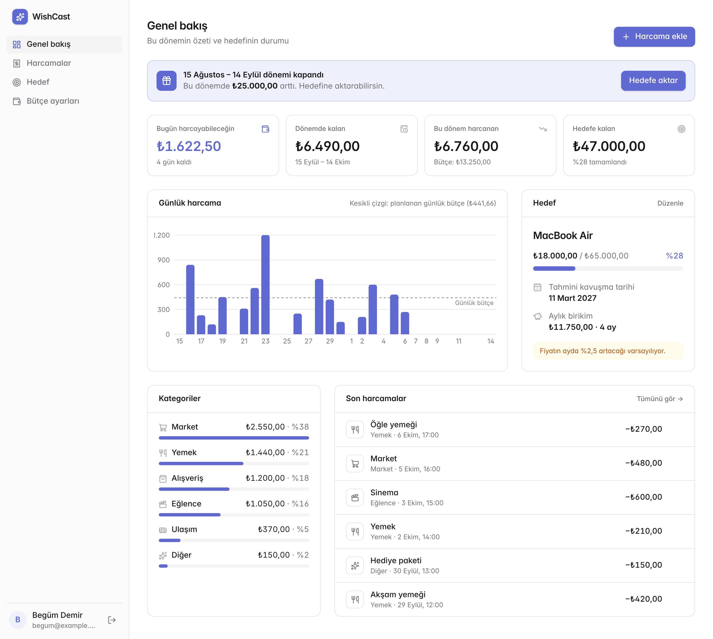
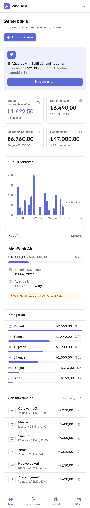
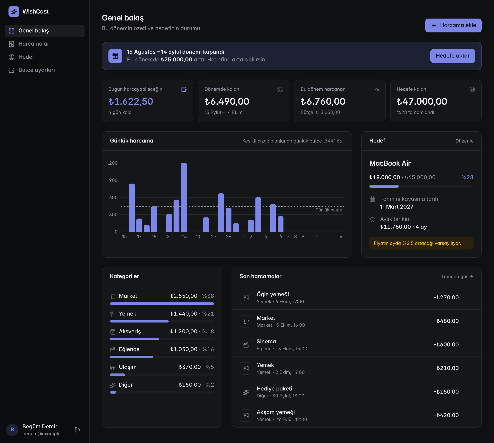

# 🔮 WishCast

**Forecast the day you get what you want.**


Most budgeting apps look backwards: *"Where did my money go last month?"*
WishCast looks forward. Tell it your income, the thing you want and when you want it.
It tells you **how much you can spend today**, shows **how much each expense delays your wish**,
and keeps **the date you'll actually get it** up to date - even as prices keep rising.

<p align="center">
  
</p>

<p align="center">
  
  &nbsp;
  
</p>

---

## ✨ Features

| | Feature |
|---|---|
| ✅ | **Daily allowance:** "You can spend ₺2.062,50 today and stay on track." |
| ✅ | **Wish forecast:** estimated purchase date, recalculated on every request |
| ✅ | **Inflation-aware goals:** the price of your wish grows every month, and so does the target |
| ✅ | **Expense impact:** "That coffee pushed your iPhone back by 1 day." |
| ✅ | **Payday-based periods:** budgets follow *your* payday, even on the 31st in February |
| ✅ | **Period close:** what you didn't spend is moved into your wish, exactly once |
| ✅ | **Feasibility check:** if the goal is impossible in time, WishCast shows the earliest realistic date |
| ✅ | **Expenses page:** browse past periods, filter by category |
| ✅ | **Dashboard:** KPI cards, daily spending chart vs. planned daily budget, category breakdown |
| ✅ | **Professional UI:** sidebar app shell, add-expense dialog, toasts, automatic dark mode, mobile tab bar |
| ✅ | Sign in with GitHub; every user sees only their own data |

## 🧮 How it works

All amounts are stored as **integer kuruş** (1 ₺ = 100 kuruş), so there are no floating-point surprises.

```
monthly saving needed = ⌈ (price − saved) / months left ⌉
spendable this period = income − fixed expenses − monthly saving
daily allowance       = ⌊ (spendable − spent so far) / days left (incl. today) ⌋
period leftover       = income − fixed expenses − spent in period   → added to the wish
expense delay (days)  = expense / (monthly saving × 12 / 365)
```

**The forecast** simulates month by month: savings grow by the monthly saving while the price grows
by the monthly inflation rate. The first month where savings ≥ price is the wish date.

**Example:** a ₺60,000 phone, ₺10,000 already saved, ₺10,000 saved every month.

| Monthly price increase | Forecast |
|---|---|
| 0% | 5 months |
| 2% | **6 months** - inflation costs you a month |

## 🛠 Tech stack

- **Framework:** Next.js 16 (App Router, Server Actions, Cache Components / Partial Prerendering), React 19, TypeScript
- **UI:** Tailwind CSS 4 with design tokens (CSS variables, light + dark), Inter, Lucide icons, Recharts
- **Database:** Prisma 7 with the `better-sqlite3` driver adapter (SQLite in development)
- **Auth:** Auth.js v5 (GitHub OAuth) + Prisma adapter, database sessions
- **Validation & dates:** zod 4, date-fns
- **Testing:** Vitest (73 unit tests)

## 📁 Project structure

```
lib/
  money.ts           # parseTL / formatTL / toTLInput  (text ⇄ kuruş)
  plan.ts            # pure budget math: periods, allowance, forecast
  dashboard.ts       # pure: combines plan.ts into everything the dashboard shows
  closing.ts         # pure: period close rules, expense delay
  schemas.ts         # zod schemas for every form
  dashboard-data.ts  # database reads for the dashboard and period close
  history-data.ts    # database reads for the history page
  session.ts         # getSession / requireUserId
  auth.ts, db.ts     # Auth.js and Prisma client
app/
  page.tsx           # landing page (redirects to /dashboard when signed in)
  (app)/layout.tsx   # app shell: sidebar, mobile top bar and tab bar
  (app)/dashboard/   # KPIs, daily chart, categories, goal, recent expenses
  (app)/history/     # expenses by period with category filter
  (app)/goal/        # create / edit your wish
  (app)/onboarding/  # budget settings: income, payday, fixed expenses
  actions.ts         # Server Actions (save, add/delete expense, close period)
components/          # AllowanceCard, QuickExpense, ImpactToast, PeriodCloseCard, ...
prisma/              # schema.prisma + migrations
tests/               # Vitest unit tests
```

## 🚀 Getting started

**Requirements:** Node.js 22+, a GitHub OAuth app with the redirect URI
`http://localhost:3000/api/auth/callback/github`

```powershell
git clone https://github.com/begumhandan/WishCast.git
cd WishCast
npm install
npm install-scripts approve better-sqlite3 prisma @prisma/engines unrs-resolver   # npm 11+ only
npm rebuild better-sqlite3 prisma @prisma/engines unrs-resolver
Copy-Item .env.example .env        # macOS/Linux: cp .env.example .env
npx prisma migrate dev
npx prisma generate
npm run dev
```

Open [http://localhost:3000](http://localhost:3000).

### Environment variables

| Variable | Description |
|---|---|
| `DATABASE_URL` | `file:./dev.db` for local SQLite |
| `AUTH_SECRET` | Random secret for Auth.js (`openssl rand -base64 32`) |
| `AUTH_GITHUB_ID` | GitHub OAuth app client ID |
| `AUTH_GITHUB_SECRET` | GitHub OAuth app client secret |

## 🧪 Testing

All the money and date logic lives in pure functions with no database or framework code,
so it is fully unit tested - including paydays on the 31st in February, year boundaries,
goals that inflation makes unreachable, and periods that started before the user signed up.

```bash
npx vitest run
```

## 🧠 Design decisions

- **Integer kuruş instead of floats.** `0.1 + 0.2 !== 0.3`. Monthly savings round **up** and the
  daily allowance rounds **down**, so following the plan never leaves the user short.
- **Pure logic layer.** `plan.ts`, `dashboard.ts` and `closing.ts` take "now" as a parameter
  and never touch the database, which makes them deterministic and easy to test.
- **The user id always comes from the session, never from a form.** Every Server Action calls
  `requireUserId()`, and every write is scoped by `userId` (e.g. `deleteMany({ where: { id, userId } })`),
  so nobody can modify another user's data by guessing ids.
- **Period close is safe against double clicks and races.** The amount is recomputed on the
  server (never taken from the client), the close record and the savings increment run in one
  transaction, and a `@@unique([userId, periodStart])` constraint makes the database reject a
  second close of the same period.
- **Partial periods are not closable.** If a user signs up mid-period, that period's full income
  is not credited to the goal - only periods that start after the goal was created.
- **Expense delay uses the daily saving rate,** not a second forecast simulation. The forecast moves
  in whole months, so a ₺250 expense would show as either "0 days" or "30 days"; dividing by the
  daily saving rate gives a meaningful number for small expenses. Trade-off: it ignores inflation.
- **Cache Components.** The static shell of every page is prerendered; anything that reads the
  session sits behind `<Suspense>`, and `connection()` is called before Auth.js so its random
  CSRF token is never generated during prerendering.

## 🎨 Design

- **Calm, tool-like interface** inspired by Linear and Vercel: neutral grays, thin borders, one accent color,
  compact typography. Color is reserved for meaning - accent for "you can spend", red for overspending,
  amber for warnings.
- **Design tokens:** every color is a CSS variable in `globals.css`, exposed to Tailwind via `@theme`.
  Dark mode re-defines the same tokens, so components never contain `dark:` variants.
- **App shell:** a route group `app/(app)` shares one layout - sidebar on desktop, top bar + tab bar on mobile.
- **Charts:** one series, one hue (validated for contrast and color-vision deficiency), a dashed reference
  line for the planned daily budget, values in tooltips and labels so color is never the only cue.

## ⚠️ Known limitations

- One wish per user.
- Only the most recent finished period can be closed; missed older periods are not backfilled.
- Dates use the server's local time zone - a deployment should set `TZ=Europe/Istanbul`.
- `npm audit` reports advisories in dev tooling (`eslint-config-next`, the `prisma` CLI); the suggested
  `--force` fix downgrades to older major versions, so they are tracked until upstream releases a patch.

## 🗺 Roadmap

- [ ] Shareable progress card ("I'm 62% of the way to my wish 🎯") via `next/og`
- [ ] Real inflation data from the Central Bank of Türkiye (EVDS API)
- [ ] PWA + daily "log your expenses" reminder
- [ ] Multiple wishes with priorities
- [ ] Bank statement CSV import
- [ ] Deploy on Vercel + Neon PostgreSQL

## 📄 License

MIT
